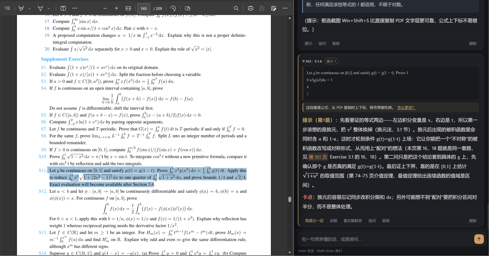

# 旁批 · 讲义伴读

**选中讲义里的一句话，侧边窗口只讲你已经学过的部分。**

读讲义卡住时，通用 AI 会把最漂亮的解法给你——包括你还没学的。旁批知道你读到第几讲第几页：超出进度的内容必须标出来源，讲义里没有的必须说明是补充。

**点击下方后在页面下面找到Assets，点击zip压缩包即可下载！**

[](https://github.com/LovableWind/Text-Tutor/releases/latest)
[](https://github.com/LovableWind/Text-Tutor/releases/latest) [](https://github.com/LovableWind/Text-Tutor/releases/latest)


支持 Windows 10 / 11 · 解压即用 · 自带 Python 运行时 · 需要自己的 API Key（一次讲解不到一分钱）



---

## 三步开始

1. 解压到任意文件夹（**别**在压缩包里直接双击）
2. 双击 **`旁批.exe`**
3. 点右上角 **⚙** 填 API Key → 测试连接 → 正常；再点顶部胶囊导入讲义

第一次运行若被 Windows 拦（「此文件可能有害」），点 **更多信息 → 仍要运行**——这是未签名程序的常规提示，之后不再出现。

API Key 到 [DeepSeek 开放平台](https://platform.deepseek.com) 注册后创建。不想用它，见下面的[换模型](#换模型)。

## 它解决什么问题

| 通用 AI | 旁批 |
| --- | --- |
| 不知道你学过什么 | 知道你读到第几讲第几页 |
| 顺手用后面的定理，你根本没法验证 | 超出的内容标 `⏭ 引申 · 第3讲 2.2 节（第 4 页）`，不展开 |
| 讲义没有的东西说得像讲过 | 标 `➕ 补充`，先把补的东西讲清楚 |
| 选中习题直接给答案 | 先问你要：只翻译 / 给提示 / 讲解 |

### 两个标记长什么样

用到后面才讲的内容：

```
⏭ 引申 · 1.4《实数的确界原理》（第 4 页）：它保证"所有上界中最小的那个"确实存在，
这里只是把 A 指出来，不展开。
```

用到讲义里根本没有的东西：

```
➕ 补充：这里用的是数学归纳法，课内没讲——先证 n=1 成立，再假设 n=k 成立推出 n=k+1。
```

正文里**不允许出现**超出当前页的引用；模型生成后还有一层自查，越界会自动重写一遍。

## 怎么用

### 取词

- **文字**：在任意 PDF 阅读器里选中一句话 → `Ctrl+C`（或 `Ctrl+Alt+D` 强制取词）
- **公式 / 手写**：`Win+Shift+S` 框选，截完自动进剪贴板

从 PDF 复制公式经常丢上下标（`∫₀¹x²dx` → `∫x2dx`），旁批会识别这种残缺式子，提示改用截图，讲解时先把式子补全再往下推。

### 习题不会直接给答案

选中一道题（有没有"习题"两个字都认——看的是句式：祈使动词、问句、选项、填空），先出三个按钮：

| 选项 | 行为 |
| --- | --- |
| 只翻译 | 只把题干译成中文，一个字不讲解 |
| 给提示 | 第 1 层只指方向，第 2 层给关键一步，第 3 层给接近完整的路线，**答案始终留白** |
| 讲解 | 你明确要了，才完整讲 |

给了提示之后，卡片上仍是 **再提示一层 / 讲解 / 看完整解答**，每一步由你决定。

### 整学期课件

把整个学期的 PPTX / PPT / PDF 一次拖进去，自动按讲次排序：

- `LECTURE_01` / `Lecture 7` / `LEC-04` / `LECTER_07`（拼错也认）
- `第一讲` / `第 3 讲` / `第十讲`
- `Chapter 1` / `Ch.2` / `Unit 4` / `Week 5`
- 裸序号：`一 绪论` / `二、极限` / `01. 概述`

你在第 2 讲第 3 页时，「已讲范围」自动等于 **第 1 讲全部 + 第 2 讲前 2 页**。排错了点课件右边的 ↑ ↓ 手动调。

PPTX 会连**备注页**一起读——讲师备注往往才是真正的解释。

### 页码可跳转

讲解里的「第 3 页」是个按钮，点一下侧栏切到那一页，后续提问的上下文跟着变。多课件时「第2讲……第 4 页」会连讲次一起跳。

### 人文社科讲义

导入时自动判断学科：出现「定理/证明/函数」走数学助教，出现「认为/观点/理论/材料」走人文社科助教。人文模式引用原文用「」并注明页码，禁止编造人名、著作、年代和引文。两套规则完全独立，数学那套不受影响。

## 换模型

设置里可以填任意 OpenAI 兼容接口：

| 服务 | Base URL | 模型 | 说明 |
| --- | --- | --- | --- |
| DeepSeek（默认） | `https://api.deepseek.com/anthropic` | `deepseek-flash` | 协议选 Anthropic，质量最稳，一次不到一分钱 |
| 智谱 | `https://open.bigmodel.cn/api/paas/v4` | `glm-4-flash` | 协议选 OpenAI 兼容，Flash 长期免费 |
| 硅基流动 | `https://api.siliconflow.cn/v1` | `Qwen/Qwen2.5-7B-Instruct` | 注册送额度 |
| 本地 Ollama | `http://127.0.0.1:11434/v1` | `qwen2.5:14b-instruct` | 完全离线，Key 随便填 |

**用 Ollama 要先调大上下文**，默认 2048 装不下讲义：

```powershell
$env:OLLAMA_CONTEXT_LENGTH = "8192"
ollama serve
```

本地小模型守不住"只用已讲内容"，会漏标 ⏭；纯 CPU 跑 7B 一段讲解要等两三分钟。有独显 + 14B 勉强能用，正经读书还是建议 API。

## 常见问题

**弹「此文件可能有害」**
Windows 给下载文件打的标记，不是病毒。`.exe` 未签名，点"更多信息 → 仍要运行"；之后不再弹。

**双击后窗口没出现**
等三秒。还没有就双击 `_internal\调试启动.bat`，黑窗口里会显示错误。

**删除文件夹提示被占用**
设置页最下方「退出旁批」，或双击 `_internal\退出旁批.bat`。关窗后服务也会在 8 秒内自动退出。

**想换一整套课件**
课件面板最下方「换一套课件」，清空后重新导入；API Key 和设置不受影响。

**改配置后第一次测试连接失败**
已经在 1.2.1 修掉了——旧版本会这样，升级即可。

## 已知限制

- **只支持 Windows**。剪贴板、全局热键、窗口置顶依赖 Win32；macOS 在 2.0 计划里。
- **扫描版 / 手写讲义没有文字层**，建不了页码索引；取词讲解仍可用，但要手动设当前页。
- **PPT 里的公式多是图片**，课件提供的是概念清单，公式本身得靠选中文字或截图。
- **讲解由模型生成，可能出错**，重要结论以讲义和课本为准。

## 隐私

API Key 明文存在本机的 `data\settings.json`，只用于请求你自己填的那个接口。讲义文本会随请求发到该服务商；旁批本身不上传任何东西，也没有服务器。

---

# 开发者

## 组成

| 模块 | 文件 | 职责 |
| --- | --- | --- |
| 本地服务 | `app/server.py` | HTTP/SSE、会话状态、卡片持久化、静态资源 |
| 取词 | `app/win32.py` | 剪贴板读写（文本/DIB→PNG）、全局热键、`Ctrl+C` 注入、置顶、拉起浏览器 |
| PDF 索引 | `app/pdftext.py` | 纯 Python 解析（xref、对象流、Flate、Type0/Type3、ToUnicode） |
| PPTX 索引 | `app/pptxtext.py` | zipfile + ElementTree 读幻灯片文字与备注，零依赖 |
| PPT 索引 | `app/ppttext.py` | 旧版 `.ppt`：手写 OLE 复合文档 + 记录遍历，只取文字 |
| 课件库 | `app/corpus.py` | 讲次排序（自然序 / 中文数字）、跨讲"已讲范围"、定位 |
| 讲义处理 | `app/handout.py` | 分页文本、质量判定、目录识别、定位（精确→3-gram）、已讲要点 |
| 题型判定 | `app/exercise.py` | 结构打分（祈使动词/问句/选项/填空）+ 模型兜底，判不准按题处理 |
| 公式识别 | `app/formula.py` | 识别文字层复制出来的残缺公式，改写提示词并提示改用截图 |
| 模型接入 | `app/llm.py` | Anthropic Messages / OpenAI 兼容双协议流式，图片输入，思考开关 |
| 边界自查 | `app/guard.py` | 抓正文里越界的页码/小节号，触发一次"只改引用"的重写 |
| 提示词 | `app/prompts.py` | 讲义边界、三类标注规则、提示阶梯、追问上下文 |
| 学科配置 | `app/profiles.py` | 数学 / 人文两套独立的角色、规则与任务模板 |
| 界面 | `web/` | 卡片流、课件面板、设置、SSE 客户端、TeX 子集与 Markdown 渲染 |
| 启动器 | `tools/launcher/Program.cs` | C# 编译的 `旁批.exe`，内嵌图标，无控制台 |
| 打包 | `tools/build_portable.py` | 裁剪运行时、写启动器、打 zip |

## 从源码运行

```powershell
python app\server.py                 # 打开窄窗
python app\server.py --no-window     # 只起服务，浏览器手动开 http://127.0.0.1:<port>/?t=<token>
```

需要 Python 3.10+，只用标准库。`--no-hotkey` 跳过全局热键，`--keep-alive` 关闭"窗口关掉就退出"的看门狗。

## 测试

```powershell
python tests\e2e.py            # 48 项端到端（本地假模型，不需要 Key）
python tests\e2e_corpus.py     # 16 项多课件：排序、跨讲定位、⏭ 引用
python tests\test_scope.py     # 22 项边界：后页正文一个字都不进提示词
python tests\test_formula.py   # 27 项公式识别
python tests\test_ordering.py  # 29 项讲次识别与排序
python tests\test_profiles.py  # 18 项学科隔离
python tests\test_exercise.py  # 23 项题型判定
python tests\test_capture.py   # 6 项取词去重
python tests\test_ppt.py       # 15 项旧版 .ppt 解析
python tests\check_wiring.py   # 前端 id 与版本号一致性
node web\tests\test_math.mjs   # 167 条 TeX 渲染断言
node web\tests\test_md.mjs     # Markdown 渲染
python tests\smoke_dist.py     # 便携包自检（需先打包）
```

真模型抽查：

```powershell
$env:DSK = "sk-..."
python tools\live_check.py
python tools\live_e2e.py "选中的句子" 2
```

## 打包与发版

```powershell
python tools\clean.py                                    # 清缓存
python tools\build_portable.py --runtime <python目录>     # 出 dist\旁批 与 zip
python tests\smoke_dist.py                               # 包自检
python tools\check_upload.py                             # 上传前核对文件数
```

`build_portable.py` 会：把 `app/web/samples` 与文档复制进 `_internal\`、裁剪运行时、放入 `旁批.exe` 与备用 bat、打 zip。顶层只保留 `旁批.exe`、`使用说明.md`、`_internal\`。

重新编译启动器（改 `tools/launcher/Program.cs` 后）：

```powershell
& "C:\Windows\Microsoft.NET\Framework64\v4.0.30319\csc.exe" /nologo /target:winexe /optimize+ `
  "/win32icon:web\favicon.ico" "/out:tools\bin\Pangpi.exe" "/r:System.Windows.Forms.dll" `
  tools\launcher\Program.cs
```

## 目录结构

```
margin-tutor/
├─ app/            后端（标准库，无第三方依赖）
├─ web/            前端（无框架）+ icon-*.png / favicon.ico
├─ tools/          构建脚本 + launcher/Program.cs
├─ tests/          测试
├─ samples/        示例讲义与示例课件
├─ dist/           打包产物（不入库）
└─ 使用说明.md      面向用户的完整说明
```

## License

MIT，见 [LICENSE](LICENSE)。
